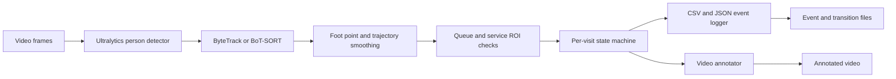

# Architecture

The video frame index divided by the source fps is the time base. Detector-specific code is isolated from the pure state machine. Event field names are centralized in the event logger.
